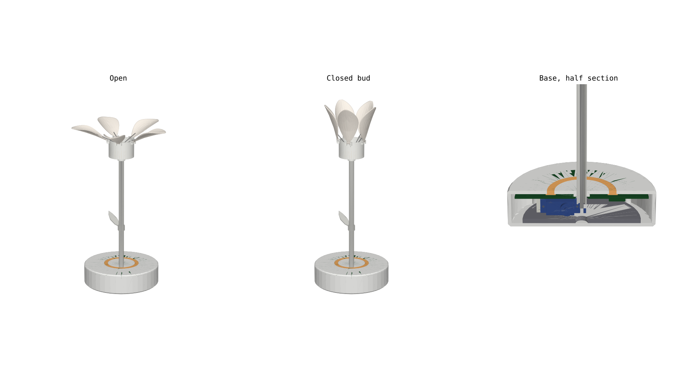

# HopeBloom

Hack Club **Fallen** project: a connected blooming flower for hospital patients and the people who love them.

Two flowers are paired over Wi-Fi. When someone touches the ring on the base of one flower, the other flower opens its petals and its core glows warm, then fades out slowly over about an hour. A way to say "I'm thinking of you" without words.

## Why
I got some inspiration from hospital patients who lived alone.

## How it works

- **Touch** the translucent ring on the base: the 8 LEDs under the ring swirl and a *bloom* is sent to the partner flower.
- **Receive** a bloom: the servo in the base pushes a rod up the stem, the 5 petals open, and the 12-LED core glows warm.
- The glow **fades over about 60 minutes**, then the petals close again.
- **Hold** the ring for 3 seconds to dismiss the glow.
- Everything electronic hides in the base: one USB-C cable powers the whole flower.

## Hardware

| Part | Details |
|---|---|
| Base | Ø120 mm, weighted with a steel disc, holds the main PCB and the servo |
| Main PCB | Round Ø108 mm, custom: ESP32-C3-MINI-1, USB-C, AMS1117-3.3, TTP223 touch, 74AHCT1G125 level shifter, 8× WS2812B |
| LED core PCB | Round Ø37 mm, 12× WS2812B, inside the flower cup |
| Mechanism | MG90S micro servo → Ø3 mm pushrod in an Ø8 mm aluminium stem → pushrod head → 5 steel links open the petals (5.7 mm travel) |
| Petals and touch ring | Translucent PETG, 3D printed |

### Pinout (ESP32-C3)

| GPIO | Function |
|---|---|
| 4 | Servo signal |
| 5 | WS2812B data (8 ring LEDs, then 12 core LEDs) |
| 6 | Touch input (TTP223, HIGH while touched) |
| 18 / 19 | USB D− / D+ (native USB, programming and serial) |
| 9 | BOOT button |
| EN | RESET button |

## 3D assembly

<!-- TODO: add a screenshot of the assembly (Onshape / Fusion) here -->

- [`cad/HopeBloom_revC_assembly_open.step`](cad/HopeBloom_revC_assembly_open.step): full assembly, petals open
- [`cad/HopeBloom_revC_assembly_closed.step`](cad/HopeBloom_revC_assembly_closed.step): full assembly, bud closed
- [`cad/step/`](cad/step): one STEP file per part (17 parts)
- [`cad/stl/`](cad/stl): the 8 parts to 3D print
- [`cad/hopebloom_model.py`](cad/hopebloom_model.py): parametric CadQuery source of the model
- [`docs/HopeBloom_HB-003_revC_drawing.pdf`](docs/HopeBloom_HB-003_revC_drawing.pdf): technical drawing with the mechanical BOM

## PCB

<!-- TODO: add screenshots of the schematics and PCBs here -->

- [`pcb/main-board/`](pcb/main-board): KiCad project for the main board in the base
- [`pcb/led-core/`](pcb/led-core): KiCad project for the 12-LED core board

Designed in KiCad 10. The ESP32-C3-MINI-1 symbol and footprint come from the official [Espressif KiCad library](https://github.com/espressif/kicad-libraries) (nickname `PCM_Espressif`). The TTP223 symbol is in `pcb/main-board/lib/HopeBloom.kicad_sym`.

## Firmware

PlatformIO project in [`firmware/hopebloom/`](firmware/hopebloom).

1. Copy `include/config.example.h` to `include/config.h`.
2. Fill in Wi-Fi, a shared `PAIR_ID`, and `DEVICE_ID` `A` on one flower and `B` on the other.
3. Plug the flower in with USB-C and run `pio run -t upload`.

The flowers talk through an MQTT broker. Each bloom is a retained message with a timestamp, so a flower that was offline still shows a bloom it missed, with the right amount of fade.

## Bill of materials

See [`bom.csv`](bom.csv). The PCBs are made and assembled by JLCPCB, and the printed parts come from JLC3DP.

## Status

- [x] Concept and mechanism (rev C)
- [x] 3D model, STEP files, technical drawing
- [x] LED core PCB: schematic, layout, DRC
- [ ] Main PCB: schematic (in progress), layout, DRC
- [ ] Gerbers for both boards
- [x] Firmware (first version, not yet tested on hardware)
- [ ] Build and test
